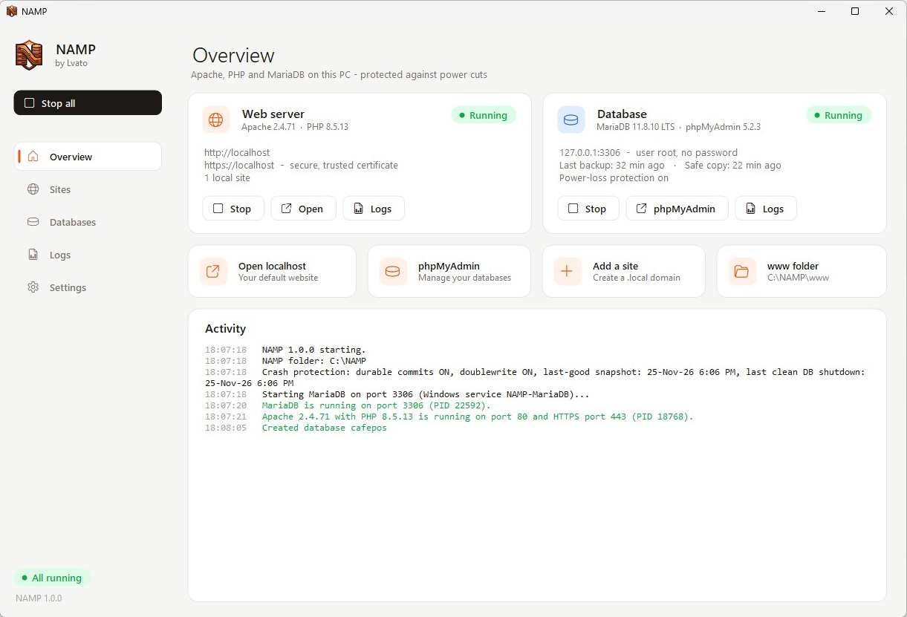
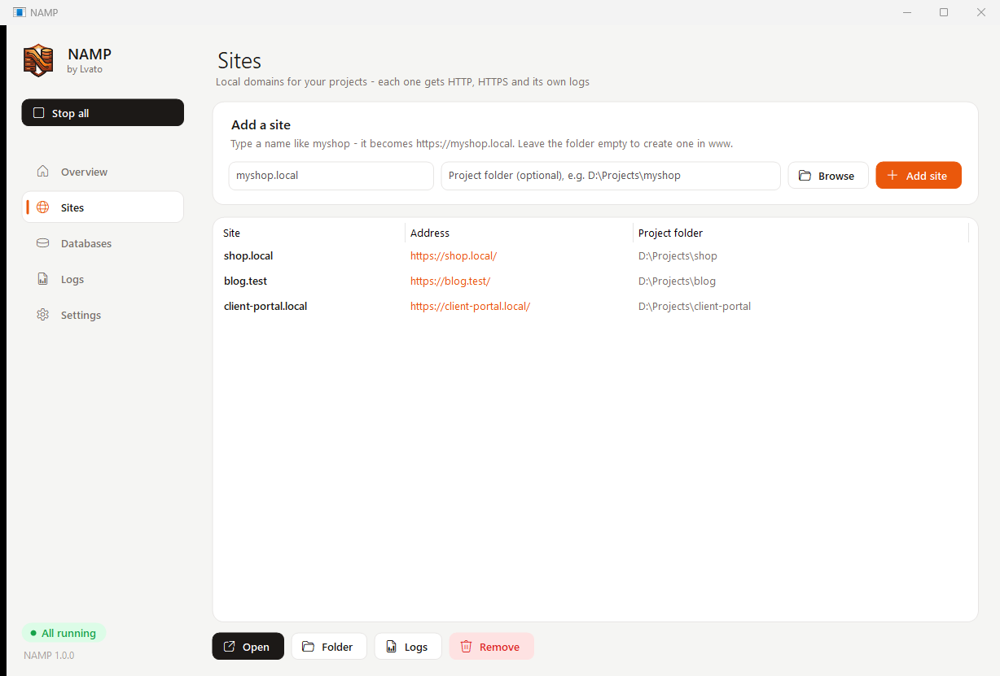
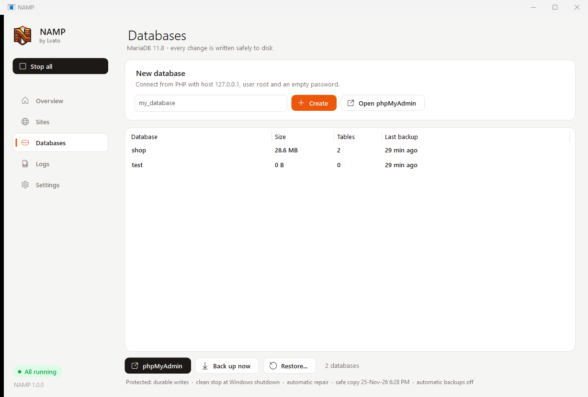
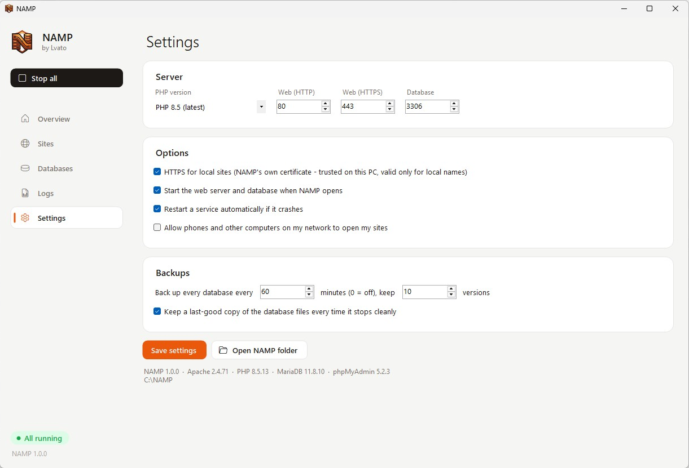

# NAMP

**NAMP** is a free local web-server environment for Windows. It packages Apache, PHP, MariaDB and phpMyAdmin in one installer, with local HTTPS domains and crash-recovery safeguards for database data.

[Download NAMP 1.0.0 for Windows](https://github.com/abdulrehman-mr/namp/releases/download/v1.0.0/NAMP-Setup-1.0.0.exe) · [View releases](https://github.com/abdulrehman-mr/namp/releases)



## Included software

- Apache HTTP Server 2.4.71
- PHP 8.5.13 and 8.3.37
- MariaDB 11.8.10 LTS
- phpMyAdmin 5.2.3

## What it does

- Starts Apache and MariaDB from one Windows app, with no administrator prompt after installation.
- Gives local projects trusted HTTPS domains such as `myshop.local`.
- Lets you switch between PHP 8.5 and PHP 8.3.
- Opens phpMyAdmin and creates project folders from the control panel.
- Protects MariaDB data with durable settings, crash recovery, last-good copies and scheduled SQL backups.

## Install and get started

1. Download and run [NAMP-Setup-1.0.0.exe](https://github.com/abdulrehman-mr/namp/releases/download/v1.0.0/NAMP-Setup-1.0.0.exe) as an administrator. The installer registers the required Windows services once.
2. Open **NAMP** from the desktop or Start menu. Apache and MariaDB start automatically.
3. Put a project in `C:\NAMP\www`, or add it from **Sites** to receive a local HTTPS domain.

Useful addresses after NAMP starts:

| Service | Address |
| --- | --- |
| Default site | <http://localhost> or <https://localhost> |
| phpMyAdmin | <https://localhost/phpmyadmin/> |
| PHP information | <https://localhost/namp/phpinfo.php> |

For PHP database connections, use host `127.0.0.1` (or `localhost`), port `3306`, user `root`, and an empty password.

## Screenshots

| Sites | Databases | Settings |
| --- | --- | --- |
|  |  |  |

## Build from source

Build on a 64-bit Windows machine. Before running the build, install:

- [7-Zip](https://www.7-zip.org/) at its default location (`C:\Program Files\7-Zip\7z.exe`)
- [Inno Setup 6](https://jrsoftware.org/isinfo.php)
- Internet access for the component downloads

The C# compiler included with the Windows .NET Framework is used; a separate .NET SDK is not required. From the repository root, run:

```powershell
powershell -ExecutionPolicy Bypass -File .\build.ps1
```

This downloads and validates components, compiles NAMP, runs the self-test, then writes the installer to `dist\`. To omit the self-test while iterating, use `-SkipTests`:

```powershell
powershell -ExecutionPolicy Bypass -File .\build.ps1 -SkipTests
```

The generated download cache, staging area, test environment, executables and installer are intentionally excluded from Git.

## Third-party software and source code

NAMP redistributes the following projects. Their license notices are included in the installed component directories; those licenses govern the respective components.

| Component | Version | License | Source / downloads |
| --- | --- | --- | --- |
| Apache HTTP Server | 2.4.71 | [Apache License 2.0](https://www.apache.org/licenses/LICENSE-2.0) | [Apache HTTP Server downloads](https://httpd.apache.org/download.cgi) |
| PHP | 8.5.13, 8.3.37 | [PHP License](https://www.php.net/license/index.php) | [PHP downloads](https://www.php.net/downloads.php) |
| MariaDB Server | 11.8.10 LTS | [GNU GPL v2](https://www.gnu.org/licenses/old-licenses/gpl-2.0.html) | [MariaDB Server source](https://github.com/MariaDB/server) |
| phpMyAdmin | 5.2.3 | [GNU GPL v2](https://www.phpmyadmin.net/license/) | [phpMyAdmin downloads and source](https://www.phpmyadmin.net/downloads/) |

## License for NAMP

NAMP's own source code does not yet have a selected license. Until a `LICENSE` file is added, the repository does not grant permission to reuse NAMP's original source code. This does not change the licenses of the bundled third-party components listed above.

## Project links

- Repository: <https://github.com/abdulrehman-mr/namp>
- Releases: <https://github.com/abdulrehman-mr/namp/releases>
